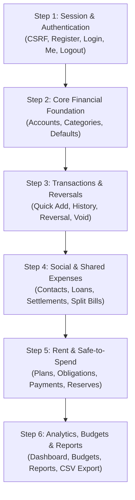

# Integration Readiness Checklist & Roadmap

## 2026-10-25 Part 6 recovery update — current status

**IMPLEMENTED / PARTIALLY COMPLETE; complete live verification BLOCKED / NO-GO.** The recovery fixed the CSV bridge's upstream content negotiation (exclusive `text/csv` caused DRF 406); actual Django CSV bytes, authenticated desktop/mobile downloads, UTF-8/BOM, selected filters, filename and formula escaping now have real passing evidence. A complete budget/expense/correction/reversal browser journey passed. Cross-user export and amended full financial tails remain NOT VERIFIED.

Fresh checks: **393 frontend tests, 62 selected backend unit tests, TypeScript, lint, production build and Django checks pass**. All **38 Part 6 desktop/mobile screen cases passed**, zero failures/skips/flaky cases (259.18s). The native authentication/read gate passed 68 real requests. These do not substitute for the unexecuted full Parts 1–6 regression. Failed runs remain preserved.

TCP diagnostics reproduced retransmissions and multi-second database queries; a four-query report took **21.722s**, exceeding the unchanged 12s proxy deadline and producing a real proxy 503. Across instrumented recovery logs, 804 completed Django requests had zero Django 5xx; this excludes proxy failures and does not erase earlier genuine Django 503s. The faulty hop remains unverified. Further financial writes stopped; a verified stable route/session-pooler address for the **same approved development database** is needed before completing the financial/security gate. No target/schema/accounting change or blind POST retry was made.

All recovery edits are in the original repository, branch `INTIGRATION`, after the owner's preserved `3d67e6f` commit. Backend changes are bounded, redacted observability only. See the [Part 6 recovery evidence](part-06-budgets-reports-export-verification.md) for exact commands, statuses, changed files, retained failures and next gates. Production-release hardening has not begun. Earlier status sections below are historical and superseded by this update.

## 2026-10-25 Part 6 integration update

**Part 6 IMPLEMENTED / PARTIALLY COMPLETE — full live verification BLOCKED / NO-GO.** The owner authorized budgets, reports and authenticated CSV after Parts 4–5. A fresh real Part 4 recovery/Part 5 rent gate passed 2/2 before source edits. Existing clean checkpoint is `INTIGRATION@611c9dc`; the previous work was committed, contrary to the historical uncommitted assumption.

Actual coverage: owned budget list/detail/create/PATCH/archive with server progress and warning thresholds; summary/trends/six expense dimensions; pinned funding reports; URL filters and transaction drill-downs; authenticated UTF-8/BOM CSV with actual metadata, filter propagation and formula protection. CSV column headers/encoding are fixed by Django; no audit checksum, deletion, budget audit-history API, breakdown percentages, direct net cash-flow field or historical income series is invented. Earlier preview-only and “Part 6 has not begun” statements below are historical.

See the [Part 6 verification report](part-06-budgets-reports-export-verification.md) for executed checks, retained failures and limitations. Final checks: 393 frontend tests, 57 selected backend unit tests, TypeScript, lint and production build pass. Live financial verification failed on actual Django/database 503s (including registration and current-user); read-only browser selection was 6 passed / 4 failed / 28 unexecuted. Further mutations stopped. CSV code exists but real downloads/ownership and the complete Part 6 journeys are not verified. Production-release hardening has not begun.

## 2026-10-25 recovery and rent integration update

**Parts 4 and 5 VERIFIED for the approved development scope.** [Part 4 recovery](part-04-people-sharing-verification.md) records the complete uninterrupted financial/security journey, measured connection churn/deadline mismatch and bounded opt-in development pool. [Part 5 rent verification](part-05-rent-reserves-verification.md) records exact contracts, all four real rent journeys and the approved friend-paid rent/reserve policy. Final checks: 335 unit tests, all 180 unique browser cases with passing evidence across full/focused runs (12 real Django-backed journeys), TypeScript, lint, cold/incremental build, Django checks and 24 selected backend unit tests. Failed attempts remain documented; no production certification is claimed.

Actual rent coverage now includes plans with immutable terms/active-only PATCH, inclusive due-date generation, owned obligations, owner/friend-paid partial payments, auditable corrections/reversals, skip/reopen, reserves and history, and authoritative spending capacity. Existing claim settlements refresh rent/reserve/dashboard/funding queries. No client ledger, FIFO or safe-to-spend calculation was added. Unsupported fields/statuses/operations remain unavailable; schema remains 68 paths / 84 operations.

The owner explicitly authorized Part 5 after the recovered Part 4 gate. Older statements below about Part 4 being blocked or Part 5 being unauthorized/previews are preserved historical checkpoints. **Part 6 budgets/general reports/CSV integration has not begun.** Existing deferred UI regression does not establish real Part 6 integration.

## 2026-10-24 Parts 3–4 integration update

**Current status: Part 3 VERIFIED for development; Part 4 IMPLEMENTED, final live verification PARTIALLY COMPLETE.** See the [Part 3 report](part-03-dashboard-funding-verification.md) and [Part 4 report](part-04-people-sharing-verification.md) for executed evidence and retained failures. Dashboard, funding sources/journeys, contacts, loans, explicit claim repayments and shared bills now use actual Django contracts. Production certification remains NOT VERIFIED; Part 5 rent/reserve workflows have not begun.

Current installed-contract validation remains **68 paths / 84 operations**. All authoritative amounts and FIFO/exhaustion results come from Django. Equal shared splits/remainders are assigned by Django; custom split input is validated exactly without implementing accounting. Relationship summaries are explicitly global because no sharing-only aggregate endpoint exists. Source/relationship search and sorting apply to complete downloaded owned lists where backend filters are absent. No missing percentages, merchant summaries or completion fields are invented.

The following sections preserve the **historical Part 2 checkpoint and roadmap**. This dated update supersedes their older statements that Part 3 has not begun or that the newly integrated modules remain previews. Actual endpoint and verification limitations are detailed in the separate reports.

Current recovery: the existing development database remains owner-approved; Part 0 is **GO** and Part 1 is **VERIFIED**. Accounts, categories and core transactions are **IMPLEMENTED / VERIFIED for the approved Part 2 development scope**. All 176 unique browser cases have passing evidence across retained and resumed runs; earlier outages remain documented. See the [Part 1 report](part-01-auth-onboarding-verification.md) for the retained authentication checkpoint.

**Document Reference:** `docs/integration/integration-readiness.md`  
**Phase:** Kivo Frontend Phase 7 (Final Verification, UI Completion & Backend Coverage Review)  
**Status:** PARTS 1–2 VERIFIED FOR DEVELOPMENT — PRODUCTION NOT CERTIFIED
**Author:** Principal Next.js Architect & Quality Engineering Lead  
**Date:** October 2026

---

## 1. Executive Summary

This document establishes the official readiness criteria, architectural prerequisites, data conventions, and sequential execution order for connecting the Kivo Next.js frontend to the remote Django REST Framework backend.

Phase 7 historically reported 200 Vitest passes, 190 Playwright passes and a successful build. The 2026-10-22 baseline reproduced 200 Vitest passes and a successful typecheck; lint passed with three existing warnings. Build and Playwright execution failed in this runner. Historical UI results do not establish integration readiness.

The [Part 0 safety audit](part-00-safety-audit.md) preserves the original NO-GO and appends the superseding owner decision: existing `postgres` is dedicated to development and approved for identifiable integration records. Its read-only connectivity check passed; a separate staging database is not required. Scoped Node build/browser execution now works.

> [!IMPORTANT]
> **Current boundary**: Authentication, profile, onboarding, accounts, categories, Quick Add, history and audited corrections use Django APIs. Dashboard metrics, Fund Journey and other later modules remain preview/pending. Part 3 has not begun.

Current Part 2 results and runtime recovery limits are recorded in the [core transactions verification report](part-02-core-transactions-verification.md); implementation is distinct from the final live verification status.

---

## 2. Readiness by Frontend Module

| Module | Route(s) | UI Components & Forms | Client Validation Schema | Backend Endpoints Target | Historical UI Status |
|---|---|---|---|---|---|
| **Auth & Onboarding** | `/login`, `/register`, `/onboarding` | `LoginForm`, `RegisterForm`, `OnboardingShell` | `loginSchema`, `registerSchema`, `accountSchema` | `/api/v1/auth/*` | READY |
| **Profile & Settings** | `/settings/profile`, `/settings/categories` | `ProfilePage`, `CategoryList`, `CategoryModal` | `categorySchema` | `/api/v1/auth/me/`, `/api/v1/categories/*` | READY |
| **Dashboard** | `/dashboard` | `FinancialSummaryGrid`, `SpendingChartCard`, `RecentActivityCard` | N/A (Display & Filters) | `/api/v1/dashboard/`, `/api/v1/accounts/summary/` | READY |
| **Accounts** | `/money` | `AccountList`, `AccountCard`, `AccountFormModal` | `accountManageSchema` | `/api/v1/accounts/*` | READY |
| **Transactions & Reversals** | `/transactions`, `/transactions/[id]` | `TransactionTable`, `QuickAddModal`, `TransactionActionModal` | `expenseSchema`, `receiptSchema`, `transferSchema`, `transactionActionSchema` | `/api/v1/transactions/*` | READY |
| **Money Sources & Attribution** | `/money/sources`, `/money/sources/[id]` | `FundingSourceList`, `FundJourneyTimeline`, `AllocationBreakdown` | `fundingFilterSchema` | `/api/v1/funds/*` | READY |
| **People, Loans & Repayments** | `/people`, `/people/[id]` | `ContactList`, `ContactModal`, `LendBorrowModal`, `RepaymentModal` | `contactSchema`, `loanSchema`, `settlementSchema` | `/api/v1/contacts/*`, `/api/v1/loans/*`, `/api/v1/claims/*`, `/api/v1/settlements/*` | READY |
| **Shared Expenses** | `/shared-expenses`, `/shared-expenses/[id]` | `SharedBillList`, `CreateSharedBillModal`, `SharedBillDetailView` | `sharedBillSchema` | `/api/v1/shared-bills/*` | READY |
| **Rent & Reserves** | `/rent` | `RentOverviewCard`, `RentPaymentModal`, `RentReserveModal`, `ObligationActionModal`, `RentGenerateModal` | `rentPlanSchema`, `rentPaymentSchema`, `rentReserveSchema`, `obligationActionSchema` | `/api/v1/rent/*` | READY |
| **Budgets** | `/budgets` | `BudgetList`, `BudgetOverview`, `BudgetModal`, `BudgetPeriodSelector` | `budgetSchema` | `/api/v1/budgets/*` | READY |
| **Analytics & Export** | `/reports` | `AnalyticsSummaryCard`, `SpendingTrendChart`, `CategoryBreakdownChart`, `CSVExportDialog` | `exportSchema` | `/api/v1/reports/*` | READY |

---

## 3. Core Architectural Decisions for Integration

### A. Session Authentication & CSRF Bootstrap
1. **Cookie-Based Sessions**: Django is the sole authentication authority, using `sessionid` (HttpOnly) and readable `csrftoken` cookies. Secure flags are enabled by production settings; active development flags are false. Current backend has no CORS middleware: use verified same-origin ingress/proxy routing, not an assumed direct cross-origin connection.
2. **Bootstrap Flow**:
   - Web client makes initial call to `GET /api/v1/auth/csrf/` on app initialization.
   - Django responds with `200 OK` and sets the `csrftoken` cookie.
   - All subsequent state-changing requests (`POST`, `PUT`, `PATCH`, `DELETE`) must extract the cookie value and include it in the `X-CSRFToken` request header.
3. **Session Lifecycle**:
   - `POST /api/v1/auth/login/` rotates session keys internally to prevent session fixation.
   - `POST /api/v1/auth/logout/` invalidates the active session and flushes cookies.
   - Registration returns a profile with 201 and does not log in. Login requires a subsequent explicit request. Registration/login need CSRF even anonymously; login rotates CSRF state too.
   - `GET /api/v1/auth/me/` returns only `id`, `email`, `name`, `date_joined`. Profile/preference updates and an onboarding-completion flag are unsupported.
   - Errors are nested under `error.details` (or `error.message` for server errors); Part 1 now normalizes those envelopes and maps supported fields.

### B. Durable Idempotency Keys (`Idempotency-Key`)
1. **Account Creation**: `POST /api/v1/accounts/` requires an owner-scoped `Idempotency-Key` (1–128 characters). Determine requirements per operation; not all metadata updates accept/require this header.
2. **Network Retry Semantics**:
   - After a timeout or `500` / `503`, reconcile the account state before a deliberate retry. Preserve the original key and identical payload. Never automatically retry an ambiguous account-creation POST.
   - An existing key with matching payload returns the account again with HTTP 200. There is no `replayed: true` response field.
   - If a request is received with an existing key but differing payload, Django returns `409 Conflict`.

### C. Exact Integer Arithmetic (Paise)
1. **Zero Floating Point Rule**: The database/services use integer paise; the HTTP API accepts and returns exact decimal INR **strings with two decimal places**, e.g. `"1450.75"`. It rejects monetary JSON numbers.
2. **Frontend Responsibility**:
   - The UI accepts standard decimal inputs from users (e.g. `1450.75`).
   - Normalize validated decimal text without floating-point arithmetic before dispatch. Account input uses `name`, `kind`, `opened_on`, `opening_balance: "1450.75"`.
   - Preserve exactness when formatting responses. Part 1 removes onboarding `parseFloat` conversion, validates real dates and normalizes exact decimal strings.
   - Opening balance is opening equity, never an artificial income transaction.

---

## 4. Recommended Sequential Integration Order

The diagram below is a historical roadmap, not blanket authorization. The current request explicitly authorizes Part 2 after its Part 1 gate. Dashboard metrics and Fund Journey remain deferred to a separately authorized Part 3.

### Step 1: Session & Authentication (`/api/v1/auth/`)
- Verify CSRF cookie capture.
- Wire `LoginForm` and `RegisterForm` with TanStack Query mutations.
- Wire `MeView` (`/api/v1/auth/me/`) into global session provider.

### Step 2: Core Financial Foundation (`/api/v1/accounts/`, `/api/v1/categories/`)
- Fetch live account balances and category lists.
- Enable `AccountFormModal` and `CategoryModal` for real account/category creation.
- Test "Seed Defaults" (`POST /api/v1/categories/defaults/`).

### Step 3: Core Transactions & Reversals (`/api/v1/transactions/`)
- Connect `QuickAddModal` for posting receipts, expenses, and transfers.
- Verify real double-entry ledger postings on transaction detail.
- Connect `TransactionActionModal` for live reversal, void, and correction mutations.

### Step 4: Social, Lending & Shared Bills (`/api/v1/contacts/`, `/api/v1/loans/`, etc.)
- Connect contact directory and net balance calculation.
- Wire `LendBorrowModal` and `RepaymentModal`.
- Wire `CreateSharedBillModal` for roommate expense splits.

### Step 5: Rent, Reserves & Safe-to-Spend (`/api/v1/rent/`)
- Wire rent plan configuration, obligation generation (`RentGenerateModal`), and rent payments.
- Connect rent reserve balance allocations.
- Verify that `GET /api/v1/rent/spending-capacity/` drives the `SafeToSpendCard` on `/dashboard` and `/rent`.

### Step 6: Budgets, Analytics & CSV Export (`/api/v1/budgets/`, `/api/v1/reports/`)
- Connect category budget thresholds and progress bars.
- Wire dashboard and report analytics charts (Recharts) to `/api/v1/reports/*`.
- Connect `CSVExportDialog` to stream `GET /api/v1/reports/export/` with user-selected headers and filters.

---

## 5. Critical End-to-End User Journeys for Integration Testing

1. **User Onboarding & First Account**:
   - Obtain CSRF -> Register -> Login -> Use rotated CSRF -> Create first account with exact opening-balance string -> Arrive at the existing dashboard.
2. **Daily Expense & Inflow Journey**:
   - Quick Add Expense -> Validate integer paise debit -> Check updated Account Balance -> Verify FIFO Funding Source Attribution.
3. **Friend Lending & Settlement Journey**:
   - Add Contact -> Lend Money (Asset swap, not expense) -> Contact owes user -> Record Partial Repayment -> Verify Claim reduction.
4. **Roommate Shared Bill Journey**:
   - Add Shared Bill -> User pays 100% -> 50% split with Roommate -> Verify user personal expense is only 50%, remaining is receivable claim.
5. **Monthly Rent & Safe-to-Spend Journey**:
   - View Rent Obligation -> Reserve Funds -> Safe-to-Spend drops -> Record Payment -> Account debited, obligation marked paid.
6. **Transaction Reversal Journey**:
   - Open Transaction -> Click Reversal -> Input reason -> Submit -> Verify mirror ledger entry posted with exact negative balance effect.

---

## 6. Readiness Verification Checklist

UI/layout/accessibility entries retain the historical Phase 7 assessment. Only the current command results and contract inventory were reverified in Part 0.

- [x] Actual resolver and regenerated OpenAPI cross-check: 68 paths, 84 operations. The previous 52-endpoint claim was incorrect; category-detail GET was omitted from the original table.
- [x] Zod v4 validation schemas written for all user-input forms.
- [x] Part 1 aligns form validation, exact decimal-string transport and nested error handling with the actual backend.
- [x] Empty, loading skeleton, and error boundary states implemented on all routes.
- [x] Responsive layout verified at 375px, 768px, and 1440px.
- [x] WCAG 2.2 AA accessibility (colors, labels, focus rings, ARIA roles) verified.
- [x] Retained Part 1 unit/component/mocked-HTTP checkpoint: 236 tests in 48 files passed.
- [x] Retained Part 1 real-session Playwright checkpoint: 175/175 passed, no failures/skips, 7.9m. Obsolete preview-only auth cases were replaced with actual integration behavior.
- [x] Current Part 2 unit/component/mocked-HTTP gate: 266 tests in 51 files passed (fresh 2026-10-24 run: 53.61s, exit 0).
- [x] Focused real Django/PostgreSQL Part 2 lifecycle: 1 passed (6.9m test, 7.3m overall, exit 0), including authoritative balances, immutable corrections, response-loss replay and two-user isolation.
- [x] All 176 unique Part 2 desktop/mobile cases have passing evidence: 60 retained passes plus 116 resumed passes (9.9m, exit 0, no skips/flaky retries). Identity comparison confirms zero missing/extra cases. This is not a single uninterrupted clean run; the prior outage failure remains documented.
- [x] Production build succeeds using the installed Node CLI with scoped runner permission.
- [x] Existing dedicated development database approved by the owner and verified by a read-only connection; no separate staging database is required.
- [x] Focused real development-database lifecycle verifies cookies, CSRF, sessions, ownership, logout and user switching; final browser regression is recorded in Part 1.
- [x] Zero mock persistence or fake database engines present in source code.

**Current decision:** **GO — Part 2 IMPLEMENTED / VERIFIED for the approved development scope**, finalized 2026-10-24. The Part 2 report records real Django financial/security evidence, all 176 unique browser cases across saved/resumed runs, current automated gates and retained failures. Remote-write latency and intermittent service availability remain runtime risks, not resolved performance claims. Production certification remains NOT VERIFIED. Part 3 has not begun and requires separate authorization.
